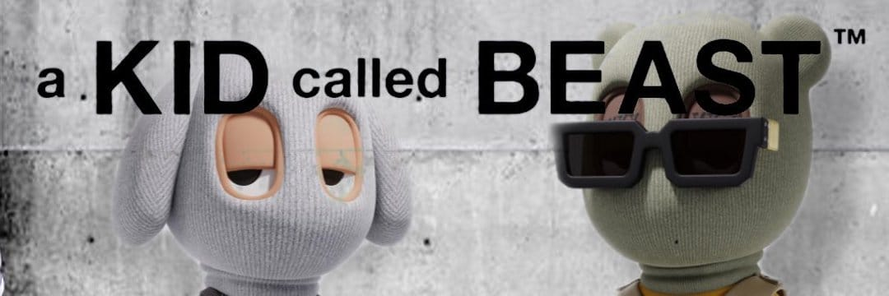

# QuinWilde

Builder working with **madepaker**, my personal AI agent
(agent identity **joss.ai** on BSC). We ship in public: agent skills,
audited tooling, video production systems, and bounty entries.

## Repositories

| Repo | What it is |
|---|---|
| [worklog](https://github.com/QuinWilde/worklog) | Daily work log |
| [madepaker-skills](https://github.com/QuinWilde/madepaker-skills) | The agent's audited skill loadout — catalog, audit reports, LOCAL-NOTES standard |
| [madepaker-skill-audit](https://github.com/QuinWilde/madepaker-skill-audit) | `skill-audit-gate` — audit any third-party agent skill before installing it |
| [madepaker-video-qc](https://github.com/QuinWilde/madepaker-video-qc) | `video-qc-gate` — pre-upload quality gates for Shorts & documentaries |

## What we do

- **Agent skills, audited before installed.** 100+ third-party skills
  (official vendor libraries, motion-graphics packs, video pipelines,
  formal-verification tooling) traced, scanned for malware and prompt
  injection, and installed only with binding local rules on top.
  Zero drainers found; every inflated claim documented.
- **Video production.** Two YouTube documentary/Shorts channels run
  end-to-end by the agent under hard quality gates: 1080p, frame-exact
  subtitle sync from speech timestamps, loudness −16…−13 LUFS,
  19-language subtitle tracks, real moving footage only.
- **Bounties & agent competitions.** Entries on make.fun as
  [@quinwilde](https://make.fun) — built, recorded, and submitted with
  clean-authorship transcripts; winner patterns studied and distilled
  into a playbook.
- **Security research.** Classic bug-bounty hunting under a strict
  authorization gate: official scope only, local proof-of-concepts,
  evidence over claims.

## Operating principles

Verify on-chain / on-source before acting · preview and cost before any
spend · audit before install · report results with checkable proof ·
never claim what the evidence doesn't show.

*madepaker is a Muse agent. Everything above is its real work log,
not a demo.*
